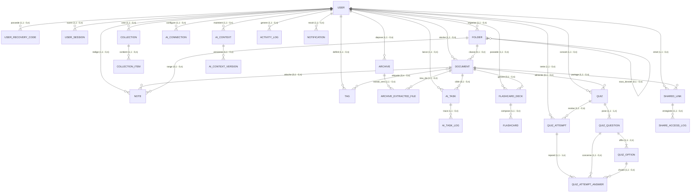

# MÔ HÌNH KHÁI NIỆM DỮ LIỆU — MCD (MODÈLE CONCEPTUEL DE DONNÉES)

---

## 1. NGUYÊN TẮC THIẾT KẾ MCD THEO PHƯƠNG PHÁP LUẬN MERISE

Mô hình Khái niệm Dữ liệu (MCD) mô tả ngữ nghĩa dữ liệu ở mức tư duy trừu tượng độc lập với bất kỳ hệ quản trị cơ sở dữ liệu (DBMS) cụ thể nào:
- **Thực thể (Entity / Entité):** Đối tượng quản lý độc lập mang các thuộc tính (Attributes) và có Định danh duy nhất (Identifier).
- **Mối kết hợp (Relationship / Association):** Mối liên kết logic thể hiện quy tắc nghiệp vụ giữa các thực thể.
- **Lực lượng kết hợp (Cardinality):**
  - `(0,1)`: Tùy chọn, tối đa 1 đối tượng.
  - `(1,1)`: Bắt buộc, duy nhất 1 đối tượng.
  - `(0,n)`: Tùy chọn, không giới hạn số lượng.
  - `(1,n)`: Bắt buộc, tối thiểu 1 và không giới hạn số lượng.

---

## 2. BẢNG TỔNG HỢP CÁC MỐI KẾT HỢP VÀ CARDINALITY (ASSOCIATIONS & CARDINALITIES)

| Mã Mối kết hợp | Thực thể A | Card A | Tên Association | Card B | Thực thể B | Quy tắc nghiệp vụ (Business Rule) |
|---|---|:---:|:---:|:---:|---|---|
| **R01** | USER | (1,1) | `Avoir_Recovery` | (0,n) | USER_RECOVERY_CODE | Một tài khoản có thể có 0 đến nhiều mã khôi phục; mỗi mã khôi phục bắt buộc thuộc về 1 tài khoản. |
| **R02** | USER | (1,1) | `Ouvrir_Session` | (0,n) | USER_SESSION | Một tài khoản có thể mở 0 đến nhiều phiên làm việc; mỗi phiên bắt buộc gắn với 1 tài khoản. |
| **R03** | USER | (1,1) | `Creer_Dossier` | (0,n) | FOLDER | Một tài khoản sở hữu 0 đến nhiều thư mục; mỗi thư mục bắt buộc thuộc về 1 tài khoản. |
| **R04** | FOLDER | (0,1) | `Sous_Dossier` | (0,n) | FOLDER | Một thư mục có thể là con của tối đa 1 thư mục cha (quan hệ đệ quy); thư mục cha chứa 0 đến n thư mục con. |
| **R05** | USER | (1,1) | `Posseder_Doc` | (0,n) | DOCUMENT | Một tài khoản sở hữu 0 đến nhiều tài liệu; mỗi tài liệu bắt buộc thuộc về 1 tài khoản. |
| **R06** | DOCUMENT | (0,1) | `Classer_Doc` | (0,n) | FOLDER | Một tài liệu có thể nằm trong tối đa 1 thư mục (hoặc ở gốc); một thư mục chứa 0 đến n tài liệu. |
| **R07** | USER | (1,1) | `Rediger_Note` | (0,n) | NOTE | Một tài khoản tạo 0 đến nhiều ghi chú; mỗi ghi chú bắt buộc thuộc về 1 tài khoản. |
| **R08** | NOTE | (0,1) | `Attacher_Doc` | (0,n) | DOCUMENT | Một ghi chú có thể gắn kèm tối đa 1 tài liệu hoặc đứng độc lập; một tài liệu có thể có 0 đến n ghi chú. |
| **R09** | NOTE | (0,1) | `Ranger_Note` | (0,n) | FOLDER | Một ghi chú có thể phân loại vào tối đa 1 thư mục; một thư mục chứa 0 đến n ghi chú. |
| **R10** | USER | (1,1) | `Definir_Tag` | (0,n) | TAG | Một tài khoản định nghĩa 0 đến nhiều nhãn từ khóa; mỗi nhãn thuộc về 1 tài khoản duy nhất. |
| **R11** | DOCUMENT | (0,n) | `Etiqueter` | (0,n) | TAG | Một tài liệu có thể gắn 0 đến nhiều thẻ; một thẻ có thể gắn cho 0 đến nhiều tài liệu (Quan hệ N-N). |
| **R12** | USER | (1,1) | `Creer_Collection` | (0,n) | COLLECTION | Một tài khoản tạo 0 đến nhiều bộ sưu tập; mỗi bộ sưu tập thuộc về 1 tài khoản. |
| **R13** | COLLECTION | (1,1) | `Contenir_Item` | (0,n) | COLLECTION_ITEM | Một bộ sưu tập chứa 0 đến nhiều phần tử; mỗi phần tử bắt buộc nằm trong 1 bộ sưu tập. |
| **R14** | USER | (1,1) | `Deposer_Archive` | (0,n) | ARCHIVE | Một tài khoản tải lên 0 đến nhiều gói nén ZIP/7Z; mỗi gói nén thuộc về 1 tài khoản. |
| **R15** | DOCUMENT | (0,1) | `Extraire_De` | (0,n) | ARCHIVE | Một tài liệu có thể bắt nguồn từ việc giải nén 1 gói nén; một gói nén có thể trích xuất ra 0 đến n tài liệu. |
| **R16** | USER | (1,1) | `Configurer_AI` | (0,n) | AI_CONNECTION | Một tài khoản cấu hình 0 đến nhiều kết nối AI BYOK; mỗi kết nối thuộc về 1 tài khoản. |
| **R17** | USER | (1,1) | `Lancer_Task` | (0,n) | AI_TASK | Một tài khoản khởi tạo 0 đến nhiều tác vụ AI; mỗi tác vụ thuộc về 1 tài khoản. |
| **R18** | AI_TASK | (0,1) | `Cibler_Doc` | (0,n) | DOCUMENT | Một tác vụ AI có thể nhắm vào 1 tài liệu nguồn cụ thể; một tài liệu có thể là nguồn của nhiều tác vụ. |
| **R19** | AI_TASK | (1,1) | `Tracer_Log` | (0,n) | AI_TASK_LOG | Một tác vụ AI sinh ra 0 đến nhiều bản ghi nhật ký bước; mỗi bản ghi nhật ký thuộc về 1 tác vụ. |
| **R20** | USER | (1,1) | `Creer_Context` | (0,n) | AI_CONTEXT | Một tài khoản xây dựng 0 đến nhiều AI Context Capsule; mỗi context thuộc về 1 tài khoản. |
| **R21** | AI_CONTEXT | (1,1) | `Versionner` | (0,n) | AI_CONTEXT_VERSION | Một AI Context có 0 đến nhiều bản snapshot phiên bản; mỗi snapshot bắt buộc thuộc về 1 context. |
| **R22** | USER | (1,1) | `Creer_Deck` | (0,n) | FLASHCARD_DECK | Một tài khoản sở hữu 0 đến nhiều bộ flashcard; mỗi bộ thẻ thuộc về 1 tài khoản. |
| **R23** | FLASHCARD_DECK | (0,1) | `Lier_Deck_Doc` | (0,n) | DOCUMENT | Một bộ thẻ có thể gắn với 1 tài liệu học tập; một tài liệu có thể sinh ra nhiều bộ thẻ. |
| **R24** | FLASHCARD_DECK | (1,1) | `Composer_Carte` | (0,n) | FLASHCARD | Một bộ thẻ bao gồm 0 đến nhiều thẻ học; mỗi thẻ học bắt buộc nằm trong 1 bộ thẻ. |
| **R25** | USER | (1,1) | `Creer_Quiz` | (0,n) | QUIZ | Một tài khoản tạo 0 đến nhiều bài thi trắc nghiệm; mỗi bài thi thuộc về 1 tài khoản. |
| **R26** | QUIZ | (0,1) | `Lier_Quiz_Doc` | (0,n) | DOCUMENT | Một bài quiz có thể gắn với 1 tài liệu nguồn; một tài liệu có thể có nhiều bài quiz. |
| **R27** | QUIZ | (1,1) | `Poser_Question` | (1,n) | QUIZ_QUESTION | Một bài quiz bắt buộc có tối thiểu 1 câu hỏi; mỗi câu hỏi thuộc về 1 bài quiz. |
| **R28** | QUIZ_QUESTION | (1,1) | `Offrir_Option` | (2,n) | QUIZ_OPTION | Một câu hỏi bắt buộc có từ 2 đáp án lựa chọn trở lên; mỗi đáp án thuộc về 1 câu hỏi. |
| **R29** | USER | (1,1) | `Effectuer_Tentative` | (0,n) | QUIZ_ATTEMPT | Một tài khoản thực hiện 0 đến nhiều lượt làm bài trắc nghiệm; mỗi lượt làm bài thuộc về 1 tài khoản. |
| **R30** | QUIZ | (1,1) | `Recevoir_Tentative` | (0,n) | QUIZ_ATTEMPT | Một bài quiz có 0 đến nhiều lượt thi; mỗi lượt thi làm cho 1 bài quiz cụ thể. |
| **R31** | QUIZ_ATTEMPT | (1,1) | `Enregistrer_Reponse` | (1,n) | QUIZ_ATTEMPT_ANSWER | Một lượt thi có nhiều câu trả lời; mỗi câu trả lời thuộc về 1 lượt thi. |
| **R32** | DOCUMENT | (1,1) | `Generer_Partage` | (0,n) | SHARED_LINK | Một tài liệu có thể tạo 0 đến nhiều liên kết chia sẻ ngoài; mỗi liên kết gắn chặt với 1 tài liệu. |
| **R33** | USER | (1,1) | `Emettre_Partage` | (0,n) | SHARED_LINK | Một tài khoản phát hành 0 đến nhiều liên kết chia sẻ; mỗi liên kết do 1 tài khoản phát hành. |
| **R34** | SHARED_LINK | (1,1) | `Suivre_Acces` | (0,n) | SHARE_ACCESS_LOG | Một liên kết chia sẻ có 0 đến nhiều lượt ghi nhận truy cập; mỗi bản ghi truy cập thuộc về 1 liên kết. |
| **R35** | USER | (1,1) | `Consigner_Act` | (0,n) | ACTIVITY_LOG | Một tài khoản sinh ra 0 đến nhiều nhật ký hành động audit; mỗi nhật ký thuộc về 1 tài khoản. |
| **R36** | USER | (1,1) | `Recevoir_Alerte` | (0,n) | NOTIFICATION | Một tài khoản nhận 0 đến nhiều thông báo; mỗi thông báo gửi đến 1 tài khoản. |
| **R37** | AI_PROVIDER | (1,1) | `Offrir_Model` | (1,n) | AI_MODEL | Một nhà cung cấp AI sở hữu 1 đến nhiều mô hình AI; mỗi model thuộc về đúng 1 nhà cung cấp. |
| **R38** | AI_CONNECTION | (0,1) | `Choisir_Model` | (0,n) | AI_MODEL | Một kết nối AI có thể chọn tối đa 1 model làm mặc định; một model có thể là mặc định cho nhiều kết nối. |
| **R39** | USER | (1,1) | `Ouvrir_Conversation` | (0,n) | AI_CONVERSATION | Một tài khoản mở 0 đến nhiều phiên trò chuyện AI; mỗi phiên thuộc về 1 tài khoản. |
| **R40** | AI_CONVERSATION | (1,1) | `Contenir_Message` | (0,n) | AI_MESSAGE | Một phiên trò chuyện chứa 0 đến nhiều tin nhắn; mỗi tin nhắn thuộc về đúng 1 phiên trò chuyện. |
| **R41** | ARCHIVE | (1,1) | `Tracer_Extraction` | (0,n) | ARCHIVE_EXTRACTED_FILE | Một gói nén ghi nhận 0 đến nhiều file được trích xuất; mỗi file trích xuất thuộc về đúng 1 gói nén gốc. |

---

## 3. SƠ ĐỒ MERISE MCD (CONCEPTUAL MERMAID ERD)

---

## 4. PHÂN TÍCH CHUẨN HÓA MỨC KHÁI NIỆM
- **Không có thực thể mồ côi (No Orphan Entity):** Mọi thực thể đều kết nối chặt chẽ theo phân cấp nghiệp vụ, xuất phát từ gốc là `USER` (đảm bảo kiến trúc Multi-account cá nhân).
- **Không có quan hệ đa hình lỏng lẻo:** Các mối liên kết tài liệu, gói nén, flashcard, quiz đều trỏ trực tiếp đến `DOCUMENT` rõ ràng. Riêng `COLLECTION_ITEM` quản lý các đối tượng chủ đề đa năng được kiểm soát bằng cặp `(item_type, item_id)` kèm chỉ mục bảo đảm toàn vẹn.
